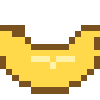
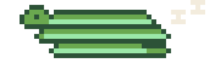

**george stevenson** · johannesburg, south africa

open-source tinkerer and LL.M. student in cybercrime & international law.
i make small, cozy tools — the kind that feel like a warm mug on a cold night.

> *"i myself am made entirely of flaws, stitched together with good intentions."* — augusten burroughs
> *(basically the job description for pixel art, too.)*

---

## 🎮 character sheet

| stat | value |
| --- | --- |
| ⚔️ class | cozy open-source gremlin |
| 🧭 base camp | johannesburg, ZA (GMT+2) |
| 📚 side quest | LL.M. in cybercrime, cybersecurity & international law |
| 🐕 companion | a very good dog |
| 🍌 fuel | bananas — with extra banana |
| 🛠️ toolkit | python · rust · qt/kde · linux |

---

## 🗺️ the party

| | project | about |
| --- | --- | --- |
| 🐀 | [**Packrat-Backup**](https://github.com/setzor/Packrat-Backup) | a KDE Plasma/Qt native backup app. the packrat hoards your files — somewhere safe, on a schedule. kinda like Déjà Dup, but Qt-er ;-) |
| 🍦 | [**scooper-cms**](https://github.com/setzor/scooper-cms) | a lightweight CMS for fun little news sites and cozy blogs. scoop, serve, repeat. |

---

## 📊 pixel stats

---

## 🐍 the contribution snake

*he naps six days a week and eats commits in his dreams.*

---

## 📫 come say hi

thanks for wandering by — the kettle's on. 🍌

